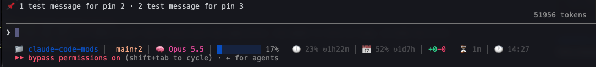
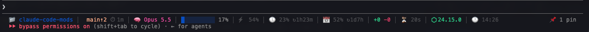

# pin-board

Pins standing notes with `/pin`. Claude keeps following them after `/compact` and `/clear`, and you see them above the prompt, or as a counter under it. Pins you keep come back after a restart.



## Use

- `/pin <note>`: pins a note.
- `/pin <note> --keep`: pins a note and keeps it for this folder.
- `/pin`: lists the pins.
- `/unpin <n>` or `/unpin all`: removes pins. The rest are renumbered.

A pin lasts until you quit Claude Code. A kept pin is stored for the folder you started Claude Code in, and comes back the next time you start it there; a toast then says how many came back, so a forgotten one does not steer Claude unseen.

## Where they show

All pins share one row above the prompt, numbered for `/unpin`: `📌 1 use pnpm · 2 no force push`. A long row is cut at the edge; `/pin` lists them in full.

If that band is already busy, set **Where pins show** to `counter` in `/config`. Then only the number shows, at the right end of the line under the prompt: `📌 2 pins`.



## How Claude gets them

- When you pin or unpin, the command leaves Claude a note at once, so the change counts from your next message.
- The whole list is also part of the system prompt. Claude Code builds the system prompt again at the start of a session, after `/compact` and after `/clear`, so the pins are there each time without being sent with every message.
- Claude Code's built-in "Security default" plugin runs before the mod on Team and Enterprise plans and on a machine with managed settings. It keeps the list out of the system prompt. The mod then sends the list with your first message, and again with the first message after a compaction or `/clear`.

## Stop the skipped-hook notice

When Security default runs first, Claude Code says once a session that pin-board's `prompt.compose` hook was skipped. To stop that notice, turn on **Skip the system prompt** in `/config` (the `skipSystemPrompt` option). The mod then stops adding the list to the system prompt and always sends it with your messages, as above. On other setups this only moves the list out of the system prompt: Claude still gets it.

## Limits

- Between two rebuilds of the system prompt, it can still list a pin you removed. The unpin note tells Claude that the later change wins.
- Changing **Where pins show** or **Skip the system prompt** reloads the mod, which drops pins that are not kept.
- Pins are plain instructions to the model, not rules the engine enforces. For a hard rule, use a hook such as guardrails.

## Install

```sh
claude plugin marketplace add arasovic/claude-code-mods
claude plugin install pin-board@claude-code-mods
```

Restart Claude Code.

## Develop

```sh
claude plugin validate .
claude plugin test .
../typecheck.sh pin-board
```
