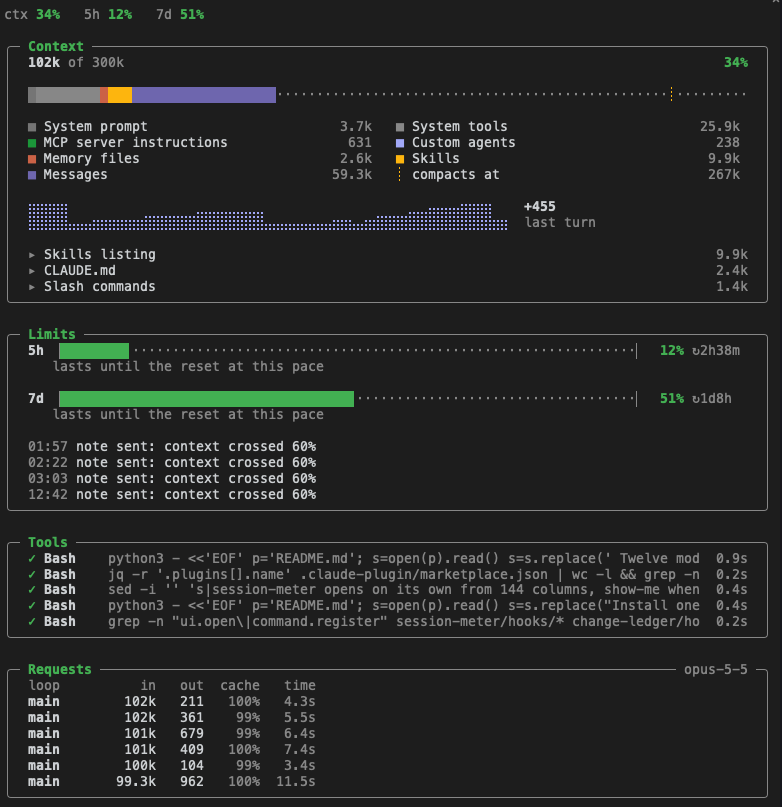

# session-meter

A docked pane that shows what is happening in a Claude Code session while you work.



## What it shows

- **Context**: what fills the context window by category, where auto-compact kicks in, the context size over turns, and the three heaviest items (memory files, MCP servers, the skills listing, slash commands, agents).
- **Limits**: the 5-hour and 7-day usage windows, time to reset, and whether the current pace lasts until the reset.
- **Tools**: recent tool calls with their target and duration; running calls stay on top, subagent calls are marked `↳`.
- **Requests**: each model request with its loop (main or subagent type), input and output tokens, cache hit rate and duration. A low cache rate turns yellow or red.

## The note to the model

It also sends the model one hidden note when a threshold is crossed, and again only after the figure drops 10 points below it:

| Threshold | What the model is told |
| --- | --- |
| 5h window at 80% | Mention it in one line and keep going |
| 7d window at 80% and 90% | Warn clearly and ask before starting a large task |
| Context at `contextAt` (60%) | When new work starts, suggest `/compact`, a fresh session, or a short handoff, whichever fits |

The note goes in as prompt context, not as a system prompt change, so the prompt cache is not invalidated. The pane lists the last five notes it sent.

## Letting the model reset the context

By default the model only suggests a reset and you decide. Two options in `/config` change that:

| Option | Values | What it does |
| --- | --- | --- |
| `contextAction` | `suggest` (default) | The model suggests `/compact` or a fresh session. |
| | `compact` | The model gets a `context_reset` tool. At a natural break it calls the tool. When the turn ends, the mod compacts the conversation and sends the model its next step, so the work goes on. A message you send while it compacts carries that step instead, and the mod drops its own step message, so the step never arrives after the work it names. The mod hands the step on only once its compact call (`/compact` in the desktop app) has returned. A message that runs before that, such as a note from another session queued ahead of it, gets no step, and the step message still follows. When the next step is yours, such as a decision, the model sets `wait` and the mod compacts, then waits for you. With `wait`, the model's `next` holds what it wants to remember: the mod sends no message of its own and adds it, hidden, to the next message you send. The model writes its whole reply, question included, before it calls the tool, so you answer from what it wrote. When the compaction waits for you, the tool refuses the call until the turn has shown you some text: a model can write its reply only in its thinking, which you never see. |
| | `compact-or-clear` | As `compact`. The model can also choose a clear when the next work does not build on the conversation. A clear needs a handoff of at least 200 characters. The mod saves the handoff to `~/.claude/handoffs/`, runs `/clear`, then sends the handoff as the first message of the new session. A message you send while it clears carries the handoff instead, and the mod drops its own handoff message. |
| `contextAt` | 10 to 95, default 60 | The context percentage that sends the note. |

The tool refuses a call below `contextAt` and a call from a subagent. A plain headless run (`claude -p`) gets no tool and only the suggestion, since it ends with the turn. The desktop app also runs Claude Code headless, but it stays open: there the mod compacts by queueing a bare `/compact` once the turn ends, so a hook that vetoes the compaction shows no "skipped" toast. The step goes only in the message that follows, so you see it, and the model reads it, once. When you interrupt the turn, no reset runs. The old conversation stays available with `/resume`.

How this differs from Claude Code's own auto-compact:

| | Built-in auto-compact | `contextAction` |
| --- | --- | --- |
| Who decides | A fixed threshold near the window limit | The model, at a natural break after `contextAt` |
| When it runs | Whenever the threshold is crossed, even mid-task | When the turn that called the tool ends |
| What carries over | The engine's summary | The summary, steered by the model's `next` step, which is also sent as the next prompt; with `wait`, the mod waits for you and adds `next` to your next message |
| A fresh start | No | With `compact-or-clear`, a `/clear` that needs a written handoff |

Auto-compact stays on. The mod only resets earlier, at a moment the model chooses.

### Idle compaction

Claude Code can also compact a long conversation on its own while the session is idle, before the one-hour prompt cache expires. The transcript then shows "Compacted while idle, before the prompt cache expired". Anthropic turns this on from its side; no setting turns it on.

Idle compaction does not know about `contextAction`, and the two can overlap:

- It does not wait for `contextAt` or for a natural break. It can compact between two steps of a task you paused, and it sends no next step.
- After the mod compacts, a conversation that is still long can be compacted again while you are away, so more detail is lost.
- If an idle compaction leaves the context below `contextAt`, `context_reset` refuses until the context fills again.

To leave resets to the model and to the built-in auto-compact, turn idle compaction off in `~/.claude/settings.json`:

```json
{ "idleCompaction": false }
```

Setting it to `true` does not turn it on. Checked in Claude Code 2.1.300.

## Install

```sh
claude plugin marketplace add arasovic/claude-code-mods
claude plugin install session-meter@claude-code-mods
```

Restart Claude Code. The pane opens on its own in a terminal 144 columns or wider; otherwise type `/ctx`. In the desktop app it does not open on its own, since the app shows context in its own sidebar; `/ctx` opens it there too. It docks beside the transcript in fullscreen mode, from 110 columns.

To keep the screen clear, turn off **Open the pane at start** in `/config` (the `autoOpen` option). `/ctx` still opens the pane, and the notes to the model still go out.

## Notes

- Context percentages come from the same breakdown as `/context`, so they follow `CLAUDE_CODE_AUTO_COMPACT_WINDOW` if you set it.
- Usage limits show after the first model reply of a session; pace needs about 10 minutes of history in the current window.
- Everything stays local. The pane reads Claude Code's own session data and makes no network calls.

## Develop

```sh
claude plugin validate .
claude plugin test .
../typecheck.sh session-meter
```
